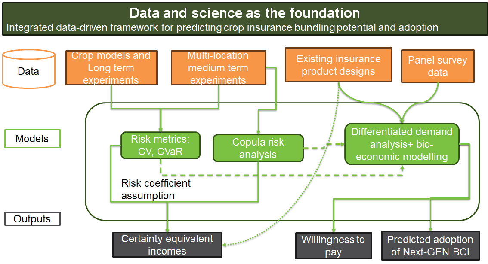

# APT4NextGenBCI
APT4NextGenBCI is an Adoption Prediction Toolbox for Next Gen Bundled crop insurance products. It combines risk metrics (from crop simulation models, agronomic trials, surveys, and climate data) with readily available demographic and farm level survey data to predict whether particular features of agricultural practices and insurance products can be bundled to increase adoption.

It relies on a differentiated demand modeling approach.

